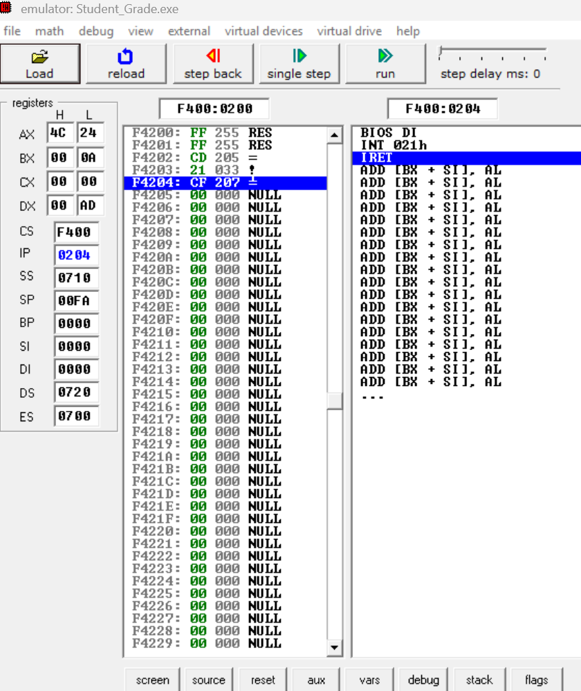
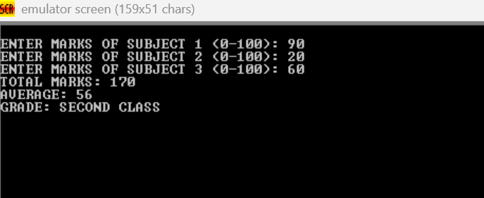
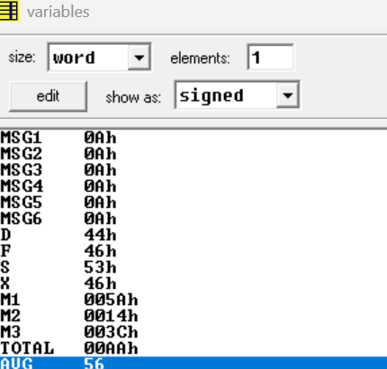

# PROJECT REPORT
# STUDENT MARKS AND GRADE CALCULATOR USING 8086 ASSEMBLY LANGUAGE

**Subject:** Computer Organization and Architecture (COA)  
**Programming Language:** 8086 Assembly Language  
**Development Environment:** EMU8086  
**Project Type:** Academic / Microprocessor Programming Project

---

# TABLE OF CONTENTS

1. Abstract
2. Introduction
3. Background and Related Work
4. Problem Statement
5. Objectives
6. Scope of the Project
7. Methodology
8. System Architecture
9. Algorithm and Working Principle
10. Implementation
11. Assembly Language Instructions Used
12. Testing and Results
13. Screenshots and Output Analysis
14. Advantages
15. Limitations
16. Conclusion
17. Future Scope
18. References

---

# 1. ABSTRACT

The Student Marks and Grade Calculator is an 8086 Assembly Language-based application developed as part of the Computer Organization and Architecture (COA) project. The primary purpose of this project is to demonstrate the practical application of 8086 microprocessor instructions in performing arithmetic calculations, accepting user input, processing numerical data, and implementing decision-making operations.

The program accepts marks obtained by a student in three different subjects through the keyboard. It calculates the total marks and average marks using arithmetic instructions supported by the 8086 instruction set. Based on the calculated average, the program determines the student's academic grade according to predefined grading criteria.

The grading system consists of four categories: Distinction, First Class, Second Class, and Fail. The classification is implemented using comparison instructions and conditional jump operations.

The project is developed and executed using the EMU8086 emulator, which provides an environment for writing, assembling, executing, and debugging 8086 Assembly Language programs. The implementation uses registers, memory variables, arithmetic operations, procedures, and DOS interrupt services for input and output operations.

This project provides practical exposure to low-level programming and helps in understanding how a processor executes arithmetic calculations and decision-making instructions. It demonstrates how a simple real-world academic problem can be solved using fundamental concepts of microprocessor programming.

**Keywords:** 8086 Microprocessor, Assembly Language, EMU8086, Arithmetic Operations, Conditional Jump, Grade Calculation, Computer Organization and Architecture.

---

# 2. INTRODUCTION

## 2.1 Overview

Computer Organization and Architecture deals with the internal structure, functionality, and operational behavior of computer systems. It explains how a processor executes instructions, performs arithmetic and logical operations, accesses memory, and communicates with input and output devices.

The 8086 microprocessor is a 16-bit processor introduced by Intel. It supports an instruction set that allows programmers to perform data transfer, arithmetic calculations, logical operations, comparisons, branching, and other computational tasks.

Assembly Language provides a low-level programming interface through which programmers can directly work with processor registers, memory locations, and instructions.

The Student Marks and Grade Calculator is designed to demonstrate these concepts through a practical academic application.

The program accepts marks in three subjects, calculates the total and average, and determines the final grade based on the specified academic rules.

Instead of using a high-level programming language, the complete calculation is performed using 8086 Assembly Language instructions.

## 2.2 Project Overview

The application follows a simple input-process-output approach.

**Input:**
- Marks obtained in Subject 1.
- Marks obtained in Subject 2.
- Marks obtained in Subject 3.

**Processing:**
- Calculate the total marks.
- Calculate the average marks.
- Compare the calculated performance with grading thresholds.
- Determine the appropriate grade.

**Output:**
- Total marks.
- Average marks.
- Final grade.

The application runs directly inside the EMU8086 emulator and displays the results through its emulator screen.

## 2.3 Importance of the Project

This project demonstrates the relationship between theoretical microprocessor concepts and practical programming.

It provides an understanding of:

- Register-based arithmetic operations.
- Data storage using memory variables.
- Conversion of keyboard input into numerical values.
- Division and remainder operations.
- Conditional execution and branching.
- Procedure-based programming.
- Input and output using software interrupts.

Through this implementation, fundamental 8086 programming concepts are applied to solve a practical problem.

---

# 3. BACKGROUND AND RELATED WORK

## 3.1 Background of the 8086 Microprocessor

The Intel 8086 is a 16-bit microprocessor architecture that uses 16-bit registers and supports segmented memory addressing.

It consists of two major functional units:

**1. Bus Interface Unit (BIU)**

The Bus Interface Unit is responsible for fetching instructions, handling memory addresses, and managing communication with memory and input/output devices.

**2. Execution Unit (EU)**

The Execution Unit decodes and executes instructions. It contains the Arithmetic Logic Unit (ALU), general-purpose registers, and control circuitry required for processing operations.

The 8086 architecture supports several categories of instructions, including:

- Data transfer instructions.
- Arithmetic instructions.
- Logical instructions.
- Shift and rotate instructions.
- Branch and jump instructions.
- String manipulation instructions.

These instructions provide the foundation for developing programs such as the Student Marks and Grade Calculator.

## 3.2 Assembly Language Programming

Assembly Language is a low-level programming language that uses mnemonic instructions to represent machine-level operations.

Unlike high-level languages, Assembly Language allows direct interaction with processor registers and memory locations.

For example:

```asm
MOV AX, 50
ADD AX, 20
```

The first instruction stores the value 50 in the AX register. The second instruction adds 20 to the existing value.

The final result stored in AX is 70.

In this project, similar instructions are used to calculate the total marks and average marks.

## 3.3 Arithmetic Operations in 8086

Arithmetic operations are essential for processing numerical information.

The project uses the following operations:

- Addition to calculate total marks.
- Division to calculate average marks.
- Comparison to determine the grade.

For example:

```asm
MOV AX, M1
ADD AX, M2
ADD AX, M3
MOV TOTAL, AX
```

This sequence adds the marks of all three subjects and stores the result in the TOTAL variable.

## 3.4 Conditional Branching

Conditional branching allows a program to make decisions based on the result of a comparison.

The 8086 processor provides instructions such as:

- CMP
- JE
- JNE
- JA
- JAE
- JB
- JBE

In this project, the CMP and JAE instructions are used to compare the total marks against predefined thresholds.

The program branches to the appropriate grade section depending on the comparison result.

## 3.5 Input and Output Operations

The program uses DOS interrupt 21H for keyboard input and screen output.

Some important DOS services used in the implementation are:

| Interrupt Function | Purpose |
|---|---|
| AH = 01H | Read a character from the keyboard |
| AH = 02H | Display a character |
| AH = 09H | Display a string |
| AH = 4CH | Terminate the program |

The program also uses multi-digit input processing to convert individual ASCII digits into numerical values.

## 3.6 Existing Approach and Proposed Approach

Traditional student grade calculators can be implemented using high-level languages such as C, C++, Java, or Python.

However, the objective of this project is not simply to calculate a student's grade. It is to demonstrate how the same computational problem can be solved at the microprocessor instruction level.

| Traditional High-Level Approach | Proposed 8086 Approach |
|---|---|
| Uses high-level statements | Uses assembly instructions |
| Abstracts processor registers | Directly uses processor registers |
| Uses built-in arithmetic expressions | Uses ADD and DIV instructions |
| Uses high-level conditions | Uses CMP and conditional jumps |
| Hides low-level execution details | Allows examination of registers and memory |

The proposed approach provides practical knowledge of low-level computation and processor execution.

---

# 4. PROBLEM STATEMENT

Calculating student marks and determining academic grades manually can become repetitive, especially when multiple students need to be evaluated.

A simple automated system is required to accept marks in three subjects, calculate the total and average, and assign a grade according to predefined academic criteria.

The main challenge is to implement this functionality using the 8086 Assembly Language instruction set rather than relying on high-level programming constructs.

The system must perform the following tasks:

1. Accept three subject marks from the user.
2. Store the entered marks in memory variables.
3. Calculate the total marks.
4. Calculate the average marks.
5. Compare the calculated result against the grading conditions.
6. Determine the appropriate academic grade.
7. Display the total, average, and grade.

The project addresses this problem through a simple 8086 Assembly Language program executed using the EMU8086 emulator.

---

# 5. OBJECTIVES

The major objectives of this project are:

1. To develop a student marks and grade calculator using 8086 Assembly Language.
2. To understand the practical implementation of arithmetic instructions.
3. To accept and process multi-digit numerical input through the keyboard.
4. To calculate the total marks of three subjects.
5. To calculate the average using the DIV instruction.
6. To implement grade classification using CMP and conditional jump instructions.
7. To understand the use of registers and memory variables.
8. To implement keyboard input and screen output using DOS interrupt services.
9. To execute and debug an assembly program using EMU8086.
10. To demonstrate the practical application of Computer Organization and Architecture concepts.

---

# 6. SCOPE OF THE PROJECT

The project focuses on implementing a basic academic marks calculation system using the 8086 microprocessor instruction set.

The current implementation supports:

- Input of marks for three subjects.
- Multi-digit numerical input.
- Total marks calculation.
- Average marks calculation.
- Four-category grade classification.
- Display of calculated results.
- Examination of registers and memory variables through the emulator.

The project is designed primarily for educational purposes and demonstrates fundamental microprocessor programming concepts.

The current version is limited to a single student's result per execution and does not include database storage, graphical interfaces, or student record management.

---

# 7. METHODOLOGY

The project follows a structured development methodology consisting of problem analysis, algorithm design, assembly programming, execution, and testing.

## 7.1 Requirement Analysis

The first stage involves identifying the required inputs, calculations, and output conditions.

The system requires three subject marks as input and must generate the total, average, and corresponding grade.

## 7.2 Algorithm Design

An algorithm is designed to define the sequence of operations performed by the program.

The algorithm includes:

- Reading three subject marks.
- Calculating their sum.
- Dividing the total by three.
- Comparing the total against grade thresholds.
- Displaying the final result.

## 7.3 Assembly Language Development

The algorithm is translated into 8086 Assembly Language instructions.

Memory variables are declared for storing the subject marks, total, and average.

Procedures are implemented for reading multi-digit input and displaying numerical results.

## 7.4 Execution Using EMU8086

The assembly source file is opened in the EMU8086 environment.

The program is assembled and loaded into the emulator.

After execution begins, the user enters the marks through the emulator screen.

The program performs the calculations and displays the result.

## 7.5 Testing and Verification

The implementation is tested using different combinations of subject marks.

The output is checked against the expected total, average, and grade.

The emulator's variable inspection facility is also used to verify the values stored in memory.

---

# 8. SYSTEM ARCHITECTURE

## 8.1 Overall System Architecture

The system follows a sequential processing architecture.

**Input Layer**

Accepts marks for three subjects from the user through the keyboard.

**Processing Layer**

Performs arithmetic operations using 8086 registers and memory variables.

**Decision Layer**

Compares the total marks against the grading thresholds and selects the appropriate grade.

**Output Layer**

Displays the total marks, average marks, and final grade.

## 8.2 System Flow

```text
             START
               |
               v
       Initialize Data Segment
               |
               v
      Accept Subject 1 Marks
               |
               v
      Accept Subject 2 Marks
               |
               v
      Accept Subject 3 Marks
               |
               v
        Calculate Total
               |
               v
       Calculate Average
               |
               v
      Compare Grade Thresholds
               |
       +-------+-------+
       |       |       |
       v       v       v
     >=75    >=60    >=50
       |       |       |
       v       v       v
 Distinction First  Second
             Class  Class
               |
               v
          Otherwise
               |
               v
             FAIL
               |
               v
       Display Final Result
               |
               v
              END
```

## 8.3 Memory Variables

The program uses memory variables to store input values and calculation results.

| Variable | Data Type | Purpose |
|---|---|---|
| M1 | Word | Stores Subject 1 marks |
| M2 | Word | Stores Subject 2 marks |
| M3 | Word | Stores Subject 3 marks |
| TOTAL | Word | Stores the sum of all marks |
| AVG | Word | Stores the calculated average |
| D | String | Stores Distinction message |
| F | String | Stores First Class message |
| S | String | Stores Second Class message |
| X | String | Stores Fail message |

The subject marks and calculation results are stored as word-sized values to support numerical operations.

---

# 9. ALGORITHM AND WORKING PRINCIPLE

## 9.1 Input Processing

The program prompts the user to enter marks for each subject.

The input is initially received as ASCII characters through the keyboard.

Since the keyboard returns ASCII values, the program converts each digit into its numerical equivalent.

The ASCII conversion is performed using:

```asm
SUB AL, 30H
```

For example:

The ASCII representation of the character '8' is 38H.

Subtracting 30H produces the numerical value 8.

The multi-digit input procedure combines successive digits to construct the complete number.

For example, when the user enters 80:

1. The first digit, 8, is read.
2. The current value is multiplied by 10.
3. The second digit, 0, is added.
4. The final numerical value becomes 80.

This allows the program to accept marks such as 75, 85, 95, and 100.

## 9.2 Total Marks Calculation

The total marks are calculated by adding the marks obtained in all three subjects.

Formula:

Total = M1 + M2 + M3

Example:

M1 = 90  
M2 = 20  
M3 = 60

Total = 90 + 20 + 60

Total = 170

Assembly implementation:

```asm
MOV AX, M1
ADD AX, M2
ADD AX, M3
MOV TOTAL, AX
```

Here, the AX register temporarily stores the sum before it is transferred to the TOTAL variable.

## 9.3 Average Calculation

The average is calculated by dividing the total marks by the number of subjects.

Formula:

Average = Total / 3

Using the previous example:

Average = 170 / 3

Average = 56 (integer result)

Assembly implementation:

```asm
MOV AX, TOTAL
MOV DX, 0
MOV BX, 3
DIV BX
MOV AVG, AX
```

The DIV instruction performs unsigned division.

For word division, the dividend is stored in DX:AX and the divisor is stored in BX.

The quotient is stored in AX and the remainder is stored in DX.

Since the program displays an integer average, any fractional part is discarded.

## 9.4 Grade Classification

The grade is determined by comparing the total marks against the equivalent thresholds for three subjects.

Original grading conditions:

| Average | Grade |
|---|---|
| Average ≥ 75 | Distinction |
| 60 ≤ Average < 75 | First Class |
| 50 ≤ Average < 60 | Second Class |
| Average < 50 | Fail |

Since the total is the sum of three subject marks, the equivalent total thresholds are:

| Total Marks | Grade |
|---|---|
| 225–300 | Distinction |
| 180–224 | First Class |
| 150–179 | Second Class |
| 0–149 | Fail |

This method is important because it avoids incorrect grade classification caused by truncating the average to an integer.

For example, an average of 74.67 must be classified as First Class, not Distinction.

Assembly implementation:

```asm
MOV AX, TOTAL

CMP AX, 225
JAE DISTINCTION

CMP AX, 180
JAE FIRST

CMP AX, 150
JAE SECOND

JMP FAIL
```

The JAE instruction transfers execution when the compared value is above or equal to the specified threshold in an unsigned comparison.

The appropriate grade message is then displayed.

---

# 10. IMPLEMENTATION

## 10.1 Development Environment

The project is developed using the EMU8086 microprocessor emulator.

EMU8086 provides facilities for:

- Writing Assembly Language programs.
- Assembling source code.
- Executing instructions.
- Inspecting processor registers.
- Viewing memory variables.
- Debugging program execution.
- Observing changes in processor state.

The program uses the standard 8086 Assembly Language programming model supported by the EMU8086 environment.

## 10.2 Program Structure

The assembly program is divided into the following logical sections:

### A. Data Segment

The data segment contains all messages and variables required by the program.

It includes:

- Subject input prompts.
- Total and average messages.
- Grade messages.
- Subject mark variables.
- Total and average variables.

Example:

```asm
M1 DW ?
M2 DW ?
M3 DW ?
TOTAL DW ?
AVG DW ?
```

The DW directive reserves two bytes of memory for each variable.

### B. Code Segment Initialization

The program initializes the data segment register.

```asm
MOV AX, @DATA
MOV DS, AX
```

The address of the data segment is transferred to AX and then copied into DS.

This allows the program to access the declared data variables.

### C. Input Section

The input section prompts the user to enter marks for each subject.

A separate input operation is performed for each subject.

The READNUM procedure handles multi-digit input and converts the entered ASCII digits into a numerical value.

The resulting values are stored in M1, M2, and M3.

### D. Calculation Section

The calculation section performs the addition and division operations.

The total is calculated using the ADD instruction.

The average is calculated using the DIV instruction.

The calculated values are stored in the TOTAL and AVG variables.

### E. Grade Decision Section

The grade decision section uses the CMP and JAE instructions.

The program checks the total marks against the required thresholds.

Based on the comparison result, execution is transferred to the appropriate grade label.

### F. Output Section

The output section displays:

- Total marks.
- Average marks.
- Final grade.

The DISPLAY procedure converts the numerical result into decimal digits and prints them on the emulator screen.

### G. Program Termination

The program terminates using the DOS interrupt service:

```asm
MOV AH, 4CH
INT 21H
```

This returns control to the DOS environment.

## 10.3 Procedures Used

The program uses separate procedures to make the implementation more organized.

**1. READNUM Procedure**

Purpose:

- Accepts multi-digit numerical input.
- Reads digits one by one.
- Converts ASCII digits into numerical values.
- Combines the digits into a complete number.
- Returns the final number in AX.

**2. DISPLAY Procedure**

Purpose:

- Accepts a numerical value in AX.
- Converts it into decimal digits.
- Displays the digits in the correct order.
- Uses the stack to temporarily store the digits.

The use of procedures demonstrates modular programming in Assembly Language.

## 10.4 Register Utilization

The project uses different registers for data processing.

| Register | Purpose |
|---|---|
| AX | Arithmetic operations and numerical results |
| BX | Temporary storage and division divisor |
| CX | Loop counter and digit processing |
| DX | Division remainder and output operations |
| DS | Points to the data segment |
| SI | Used for memory addressing where required |

The AX register plays a central role in the arithmetic calculations.

The BX register is used as the divisor during division and as temporary storage during input processing.

The CX register supports repetitive operations such as displaying digits.

## 10.5 Important Assembly Instructions

| Instruction | Description | Application |
|---|---|---|
| MOV | Transfers data between registers and memory | Stores marks and results |
| ADD | Adds two operands | Calculates total |
| SUB | Subtracts one operand from another | Converts ASCII digits |
| MUL | Performs unsigned multiplication | Builds multi-digit input |
| DIV | Performs unsigned division | Calculates average |
| CMP | Compares two operands | Checks grade thresholds |
| JAE | Jumps if above or equal | Selects grade |
| JMP | Performs unconditional branching | Transfers control |
| PUSH | Stores data on stack | Saves digits |
| POP | Retrieves data from stack | Restores digits |
| CALL | Calls a procedure | Executes input/display routines |
| RET | Returns from a procedure | Completes procedure execution |
| INT | Invokes a software interrupt | Keyboard and screen operations |

---

# 11. TESTING AND RESULTS

## 11.1 Testing Approach

The program is tested using different combinations of subject marks to verify that the arithmetic calculations and grade classification work correctly.

The test cases cover all four grade categories.

## 11.2 Test Case 1: Distinction

Input:

Subject 1 = 80  
Subject 2 = 75  
Subject 3 = 85

Calculation:

Total = 80 + 75 + 85 = 240

Average = 240 / 3 = 80

Expected Grade: DISTINCTION

Result: PASS

## 11.3 Test Case 2: First Class

Input:

Subject 1 = 60  
Subject 2 = 60  
Subject 3 = 60

Calculation:

Total = 60 + 60 + 60 = 180

Average = 180 / 3 = 60

Expected Grade: FIRST CLASS

Result: PASS

## 11.4 Test Case 3: Second Class

Input:

Subject 1 = 50  
Subject 2 = 50  
Subject 3 = 50

Calculation:

Total = 50 + 50 + 50 = 150

Average = 150 / 3 = 50

Expected Grade: SECOND CLASS

Result: PASS

## 11.5 Test Case 4: Fail

Input:

Subject 1 = 40  
Subject 2 = 45  
Subject 3 = 45

Calculation:

Total = 40 + 45 + 45 = 130

Average = 130 / 3 = 43

Expected Grade: FAIL

Result: PASS

## 11.6 Test Case Summary

| Test Case | Subject 1 | Subject 2 | Subject 3 | Total | Average | Expected Grade |
|---|---:|---:|---:|---:|---:|---|
| 1 | 80 | 75 | 85 | 240 | 80 | Distinction |
| 2 | 60 | 60 | 60 | 180 | 60 | First Class |
| 3 | 50 | 50 | 50 | 150 | 50 | Second Class |
| 4 | 40 | 45 | 45 | 130 | 43 | Fail |

All four grading categories are covered by the test cases.

## 11.7 Actual Execution Result

The project was executed using EMU8086 with the following sample input:

Subject 1 = 90  
Subject 2 = 20  
Subject 3 = 60

The program generated the following results:

Total Marks = 170

Average Marks = 56

Grade = SECOND CLASS

The observed result matches the expected result.

---

# 12. SCREENSHOTS AND OUTPUT ANALYSIS

The following screenshots were captured during the execution and debugging of the project using EMU8086.

## 12.1 EMU8086 Emulator and Execution Environment

The screenshot shows the EMU8086 emulator after loading the compiled Student Grade Calculator program.

The emulator displays the processor registers, segment registers, instruction pointer, memory contents, and assembly instructions.

This environment helps in observing the internal execution of the program and understanding how the processor handles instructions.



**Figure 1: EMU8086 Emulator and Program Execution Environment**

## 12.2 Program Output

The screenshot shows the actual execution of the Student Marks and Grade Calculator.

The user enters marks for all three subjects:

- Subject 1: 90
- Subject 2: 20
- Subject 3: 60

The program calculates the total as 170 and the average as 56.

Based on the grading criteria, the program displays SECOND CLASS.



**Figure 2: Student Marks and Grade Calculator Output**

## 12.3 Variable and Memory Inspection

The screenshot displays the variables window of the EMU8086 emulator.

The subject marks and calculated results are stored in memory and can be inspected in hexadecimal representation.

The observed values include:

| Variable | Decimal Value | Hexadecimal Value |
|---|---:|---|
| M1 | 90 | 005AH |
| M2 | 20 | 0014H |
| M3 | 60 | 003CH |
| TOTAL | 170 | 00AAH |
| AVG | 56 | 0038H |

This confirms that the input values and calculation results are stored correctly in the program's memory variables.



**Figure 3: Memory Variable Inspection in EMU8086**

## 12.4 Overall Result Analysis

The execution results demonstrate that the program successfully accepts multi-digit input, performs arithmetic operations, and classifies the student's performance.

The emulator's variable inspection facility also provides evidence of the values stored during program execution.

The screenshots collectively demonstrate the source program's execution environment, actual output, and internal variable storage.

---

# 13. ADVANTAGES

The project provides several advantages:

1. **Simple Implementation:** The program follows a straightforward input-process-output structure.

2. **Accurate Calculation:** Arithmetic operations are performed directly using 8086 instructions.

3. **Multi-Digit Input:** The input procedure supports marks containing multiple digits, including values such as 80, 95, and 100.

4. **Automatic Grade Classification:** The program selects the appropriate grade based on the specified conditions.

5. **Low-Level Programming Experience:** The project provides practical knowledge of processor registers, memory, arithmetic operations, and branching.

6. **Easy Execution:** The program can be assembled and executed directly using EMU8086.

7. **Educational Value:** It demonstrates the practical use of fundamental Computer Organization and Architecture concepts.

---

# 14. LIMITATIONS

Although the program performs the required calculations, the current implementation has certain limitations.

1. The program supports only three subjects.
2. The average is displayed as an integer, so fractional values are truncated.
3. The current input procedure does not implement complete range validation for marks.
4. Invalid characters and excessively long numerical inputs are not handled comprehensively.
5. The program processes one student's result per execution.
6. Student details and results are not stored permanently.
7. The application does not generate a separate marksheet or report.

These limitations can be addressed in future versions of the project.

---

# 15. CONCLUSION

The Student Marks and Grade Calculator successfully demonstrates the implementation of a practical academic calculation system using 8086 Assembly Language.

The project accepts marks in three subjects, calculates the total and average, and determines the final grade using predefined academic criteria.

The implementation makes use of fundamental 8086 instructions such as MOV, ADD, SUB, DIV, CMP, and conditional jump instructions. It also demonstrates the use of registers, memory variables, stack operations, procedures, and DOS interrupt services.

The project was developed and tested using the EMU8086 emulator. Different test cases were executed to verify the correctness of the calculations and grade classification. The internal variable inspection feature of the emulator was also used to examine the stored subject marks, total, and average values.

One of the major learning outcomes of this project is understanding how high-level computational tasks are performed through low-level processor instructions.

Overall, the project provides practical experience in 8086 Assembly Language programming and strengthens the understanding of arithmetic operations, decision-making, memory organization, and processor execution.

---

# 16. FUTURE SCOPE

The project can be extended with additional functionality in future versions.

**1. Multiple Subject Support**

The program can be modified to accept marks in more than three subjects.

**2. Student Information**

Student name, roll number, and other academic details can be incorporated.

**3. Input Validation**

Additional instructions can be implemented to ensure that marks remain within the valid range of 0 to 100.

**4. Percentage Calculation**

The program can calculate and display the student's percentage.

**5. Detailed Marksheet**

A complete marksheet containing subject-wise marks, total, average, percentage, and grade can be displayed.

**6. Multiple Student Processing**

The program can be extended to process results for multiple students in a single execution.

**7. Improved User Interface**

BIOS video interrupts can be used to create a more organized text-based interface with screen positioning and colors.

These improvements can enhance the functionality of the project while maintaining its foundation in 8086 Assembly Language.

---

# 17. REFERENCES

The following references were used for understanding the 8086 instruction set, Assembly Language programming, and DOS input/output operations.

1. Intel Corporation, *8086 Family User's Manual*, Intel Corporation. Reference material for 8086 architecture, registers, instruction set, and processor operations.

2. EMU8086, *8086 Microprocessor Emulator*. Available at: https://emu8086.com/

3. DosAsm Documentation, *DOS Interrupt Reference*. Available at: https://dosasm.github.io/docs/references/list_Interrupt.en

4. University of Massachusetts Lowell, *DOS and BIOS Interrupts*. Available at: https://faculty.uml.edu/yluo/Teaching/MicroprocessorII/resources/interrupts.pdf

5. King Fahd University of Petroleum and Minerals, *Basic Input/Output and DOS Interrupt Functions*. Available at: https://faculty.kfupm.edu.sa/COE/masud/RichText/lab3.pdf

6. University of Babylon, *DOS Functions and Interrupt 21H – Microprocessors Lecture Notes*. Available at: https://www.uobabylon.edu.iq/eprints/publication_11_20437_35.pdf

---

# 18. PROJECT REPOSITORY

**Project Title:** Student Marks and Grade Calculator Using 8086 Assembly Language

**Development Environment:** EMU8086

**Programming Language:** 8086 Assembly Language

**GitHub Repository:**  
https://github.com/SATYAM-SHARMA-07/COA-PROJECT-GRADE-CALCULATOR

**Repository Contents:**
- `Student_Grade.asm` – Main Assembly Language source code.
- `Screenshots/emu.png` – Emulator execution environment.
- `Screenshots/output.png` – Actual program output.
- `Screenshots/variables.png` – Variable and memory inspection.
- `README.md` – Project overview and setup instructions.

---

**END OF PROJECT REPORT**
