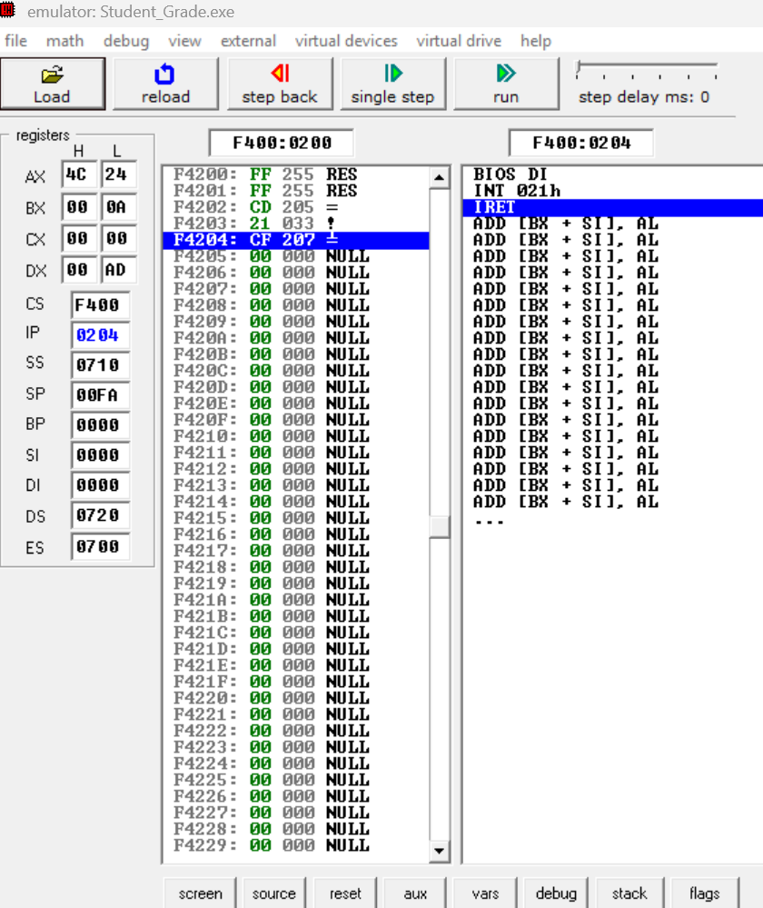
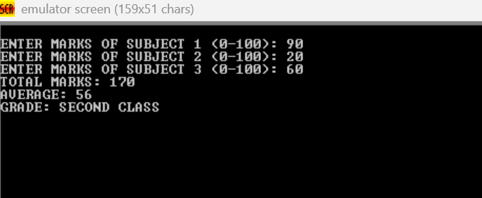
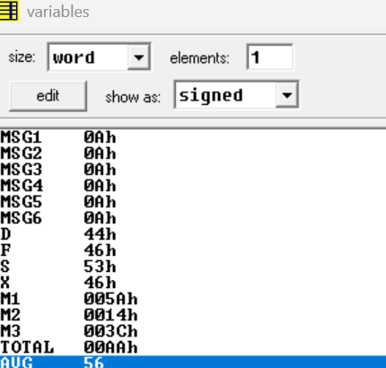

# 8086 Student Marks and Grade Calculator

A simple 8086 Assembly Language project developed using **EMU8086** that accepts a student's marks in three subjects, calculates the total and average, and determines the final grade according to predefined academic grading rules.

## 📌 Project Overview

The Student Marks and Grade Calculator is a Computer Organization and Architecture (COA) project implemented using 8086 Assembly Language.

The program takes marks in three subjects as input, performs arithmetic calculations using 8086 instructions, and classifies the student's academic performance into four categories.

## 🎯 Objectives

- Accept marks in three different subjects.
- Validate and process multi-digit numerical inputs.
- Calculate the total marks.
- Calculate the average marks.
- Determine the grade using conditional jump instructions.
- Display the final result through the EMU8086 emulator.

## 📊 Grading Criteria

The program follows these grading rules:

| Average Marks | Grade |
|---|---|
| Average ≥ 75 | Distinction |
| 60 ≤ Average < 75 | First Class |
| 50 ≤ Average < 60 | Second Class |
| Average < 50 | Fail |

## 🛠️ Technologies Used

- **Programming Language:** 8086 Assembly Language
- **IDE / Emulator:** EMU8086
- **Architecture:** Intel 8086 Microprocessor
- **Execution Environment:** EMU8086 Emulator

## ⚙️ Features

- Accepts marks ranging from 0 to 100 in each subject.
- Supports multi-digit input, including 80, 95 and 100.
- Calculates total marks using arithmetic instructions.
- Calculates average using division.
- Implements grade classification using comparison and conditional jump instructions.
- Displays total, average and final grade.
- Uses separate procedures for input and number display.

## 🧠 Assembly Instructions Used

| Instruction | Purpose |
|---|---|
| MOV | Data transfer |
| ADD | Addition of subject marks |
| DIV | Average calculation |
| CMP | Comparison of marks |
| JAE | Conditional jump for grade classification |
| INT 21H | Keyboard input and screen output |
| CALL | Procedure invocation |
| RET | Return from procedure |

## 🔄 Algorithm

1. Initialize the data segment.
2. Accept marks for Subject 1.
3. Accept marks for Subject 2.
4. Accept marks for Subject 3.
5. Calculate the total of all three subjects.
6. Divide the total by 3 to calculate the average.
7. Compare the total against the grade thresholds.
8. Assign the appropriate grade.
9. Display the total, average and grade.
10. Terminate the program.

## 📸 Project Screenshots

### 1. EMU8086 Emulator and Execution Environment

The assembly program is loaded and executed inside the EMU8086 emulator. The screenshot shows the processor registers, memory, and assembly execution environment.



### 2. Program Output

The program accepts three subject marks and displays the calculated total, average and final grade.

**Sample Input:**
- Subject 1: 90
- Subject 2: 20
- Subject 3: 60

**Expected Output:**
- Total Marks: 170
- Average: 56
- Grade: SECOND CLASS



### 3. Variable and Memory Inspection

The EMU8086 variables window displays the stored subject marks, calculated total and average in hexadecimal representation.



## ▶️ How to Run the Project

1. Download or clone this repository.
2. Install and open EMU8086.
3. Open the `Student_Grade.asm` source file.
4. Assemble the program.
5. Click on **Emulate**.
6. Run the program.
7. Enter marks for all three subjects when prompted.
8. View the total, average and final grade.

## 🧪 Sample Test Cases

| Subject 1 | Subject 2 | Subject 3 | Average | Grade |
|---:|---:|---:|---:|---|
| 80 | 75 | 85 | 80 | Distinction |
| 60 | 60 | 60 | 60 | First Class |
| 50 | 50 | 50 | 50 | Second Class |
| 40 | 45 | 45 | 43 | Fail |

## 📁 Repository Structure

```text
COA-PROJECT-GRADE-CALCULATOR/
│
├── Screenshots/
│   ├── emu.png
│   ├── output.png
│   └── variables.png
│
├── Student_Grade.asm
│
└── README.md
```

## 🎓 Learning Outcomes

Through this project, we gained practical understanding of:

- 8086 Assembly Language programming.
- Register operations and memory variables.
- Arithmetic operations using the processor.
- Division and numerical conversion.
- Conditional branching and decision-making.
- Procedures and subroutine implementation.
- Execution and debugging using the EMU8086 emulator.

## 🚀 Future Scope

- Support for additional subjects.
- Display percentage and detailed subject-wise results.
- Add student name and roll number.
- Generate a detailed marksheet.
- Introduce additional grading categories.

## 👩‍💻 Project Information

**Project Title:** Student Marks and Grade Calculator Using 8086 Assembly Language

**Subject:** Computer Organization and Architecture (COA)

**Platform:** EMU8086

**Repository:** [COA-PROJECT-GRADE-CALCULATOR](https://github.com/SATYAM-SHARMA-07/COA-PROJECT-GRADE-CALCULATOR)

---

*Developed as part of the Computer Organization and Architecture academic project.*
